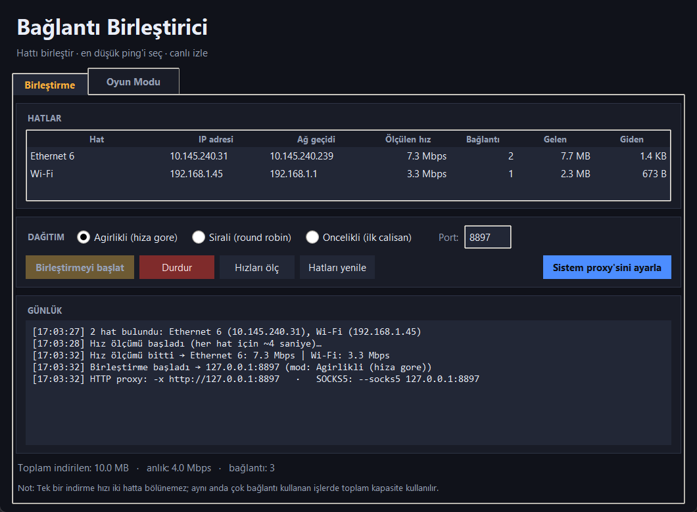
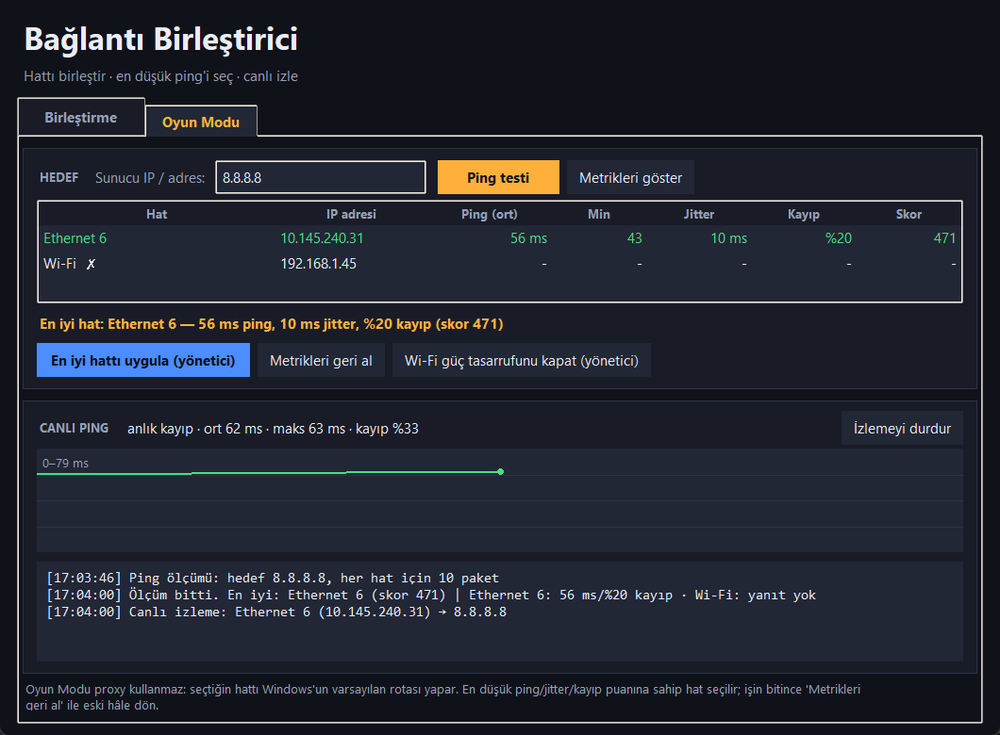

[OKU-BENI.md](https://github.com/user-attachments/files/34546176/OKU-BENI.md)
# Bağlantı Birleştirici

PC'deki **birden fazla internet hattını** (Wi-Fi + Ethernet + USB tethering) tek bir
yerel proxy üzerinden birleştiren ve **oyun için en düşük ping'li hattı** seçen
Windows uygulaması.

| Birleştirme sekmesi | Oyun Modu sekmesi |
|---|---|
|  |  |

## Bölüm 1 — Birleştirme

1. Bilgisayardaki tüm internet hatlarını (varsayılan geçidi olan adaptörler) bulur.
2. Her hattın hızını ölçer.
3. Yerel bir **HTTP + SOCKS5 proxy** açar (`127.0.0.1:8877`).
4. Proxy'ye gelen **her yeni bağlantıyı** en uygun hatta dağıtır; giden soketi o hattın
   yerel IP'sine bağladığı için trafik fiziksel olarak o adaptörden çıkar.
5. Bir hat koparsa bağlantı otomatik olarak diğer hatta taşınır (failover).

**Hızlı başlangıç:** `baslat.bat` → **Hızları ölç** → **Birleştirmeyi başlat** →
**Sistem proxy'sini ayarla** → tarayıcıdan kullan. Bitince **Durdur**; uygulama sistem
proxy'sini otomatik temizler.

| Mod | Davranış |
|---|---|
| **Ağırlıklı (hıza göre)** | Ölçülen hıza orantılı dağıtır (50 + 10 Mbps → bağlantıların ~5/6'sı hızlı hattan). |
| **Sıralı (round robin)** | Bağlantıları sırayla hatlara paylaştırır. |
| **Öncelikli (ilk çalışan)** | Listedeki ilk çalışan hattı kullanır; koparsa sonrakine geçer. |

Programları bağlamak: Edge/Chrome sistem proxy'sini kullanır; Firefox'ta
Ayarlar → Ağ Ayarları → Manuel proxy `127.0.0.1:8877`; curl için
`-x http://127.0.0.1:8877` veya `--socks5 127.0.0.1:8877`.

## Bölüm 2 — Oyun Modu (ping düşürme)

Oyun Modu **proxy kullanmaz**; doğrudan Windows rota önceliğini yönetir.

1. **Hedef** alanına oyun sunucunun IP'sini (veya `8.8.8.8` gibi sabit bir adresi) yaz.
2. **Ping testi** → her hat için 10 paket ölçüm: ort / min / jitter / kayıp / **skor**.
   Skor = `ping + 1.5 × jitter + 20 × kayıp` → küçük olan oyun için daha iyidir.
   (Örnek: %6 kayıp, 20 ms ping'ten daha kötüdür — oyunlarda kayıp ıstaka gibi hissedilir.)
3. **İki hattı da kullan + oyunu en iyiye sabitle (yönetici)** → Windows **UAC** onayı ister.
   - Oyun sunucusunun IP'si en düşük ping'li hatta **statik rota** ile sabitlenir (metrik 1).
   - Diğer tüm trafik (tarayıcı, indirme, güncelleme) **ikinci hattan** gider (varsayılan rota, metrik 20).
   - Böylece iki hat aynı anda kullanılır; oyun linki arka plan trafiğinden sıkışmaz (ping düşer).
   - **Tek-akış sınırı:** tek bir oyun bağlantısı (UDP/TCP akışı) iki hatta bölünemez. Bu yüzden
     trafik **hedefe göre** bölünür — oyun sunucusu IP'si en iyi hatta, geri kalan her şey ikinci hatta.
   - **İkinci hat sağlıksızsa** (yanıt yok veya kayıp ≥ %50) uygulama otomatik olarak **tek hat
     moduna** düşer: yalnızca en iyi hattın metriği `1` yapılır, statik rota eklenmez.
   - Eski metrikler ve eklenen rotalar `metrik_yedek.json` dosyasına kaydedilir.
   - **Metrikleri geri al** metrikleri eski hâline döndürür ve eklenen statik **rotaları da siler**.
4. **Wi-Fi güç tasarrufunu kapat (yönetici)** → kablosuz adaptörün AC/DC güç tasarrufunu
   kapatır. Wi-Fi'de görülen 150 ms'lik ping sıçramalarının en yaygın sebebi budur.
5. **Canlı izlemeyi başlat** → saniyede 1 ping, grafik + anlık/ortalama/maks/kayıp.
   Oyun oynarken ping'in nerede zıpladığını canlı görürsün.

### Ping'i gerçekten ne düşürür, ne düşürmez

- ✅ Trafiği **yanlış hattan** çıkmaktan kurtarmak (iki hat varsa) — bu modülün yaptığı iş.
- ✅ Wi-Fi güç tasarrufu / 2.4 GHz yerine 5 GHz / kanal değişimi / kablolu bağlantı.
- ✅ Arka planda indirme-güncelleme kapatmak (dar bantta ping'i en çok bu bozar).
- ❌ Oyun sunucusuna olan **fiziksel mesafe** ve ISS yolu değişmez.
- ❌ Hattın kendisinde **paket kaybı/jitter** varsa yazılım bunu düzeltemez.
- ❌ İki hat **aynı ISS'ye** çıkıyorsa (senin durumunda çıkış IP'leri aynı) birleştirme
  kapasite de eklemez.

## Sınırlar

- Tek bir indirme iki hatta bölünmez (MPTCP/karşı taraf desteği gerekir); birleştirme
  bağlantı bazındadır.
- Sistem proxy'sini yok sayan uygulamalar Birleştirme modundan etkilenmez.
- Yönetici işlemleri UAC onayı ister; onay vermezsen hiçbir şey değişmez.
- Hız/ping ölçümleri anlıktır; dalgalı hatlarda tekrar ölçmek gerekir.

## Komut satırı araçları

```powershell
python cekirdek.py           # hatları listeler, hızları ölçer, sistem proxy durumunu gösterir
python entegre_test.py       # proxy'yi açıp curl ile gerçek trafik testi yapar
python test_arayuz.py        # arayüzü pencere açmadan uçtan uca test eder
python yonetici_islem.py --islem wifi-guc --sonuc sonuc.json   # UAC olmadan "yönetici izni yok" der
```

## Sorun giderme

- **"Proxy başlatılamadı"** → port (8877) başka uygulamada; Port alanını değiştir.
- **Tarayıcı internete çıkmıyor** → uygulama kapalıyken sistem proxy'si kalmış olabilir:
  Windows Ayarlar → Ağ ve İnternet → Proxy → kapat, ya da uygulamada
  **Sistem proxy'sini kaldır**'a bas.
- **Hiç hat görünmüyor** → hatlardan birinin gerçekten internete çıkabildiğinden emin ol.
- **"Metrikler uygulanamadı (yönetici izni gerekli)"** → UAC penceresini onaylamadın
  veya yönetici izni verilmedi; uygulama sonucu okuyup doğrular, sessizce yutmaz.
- **Ping testi bir hat için "yanıt yok"** → o hat gerçekten internete çıkamıyor
  (ör. bağlı ama yönlendirme yok). Oyun Modu o hattı seçmez.

## Dosyalar

| Dosya | Görev |
|---|---|
| `arayuz.py` | Tkinter arayüzü (Birleştirme + Oyun Modu sekmeleri) |
| `cekirdek.py` | Hat keşfi, hız/ping ölçümü, dağıtıcı, proxy, sistem proxy'si, metrik/güç ayarları |
| `yonetici_islem.py` | UAC ile çalışan yardımcı (metrik uygulama/geri alma, Wi-Fi güç tasarrufu) |
| `baslat.bat` | Çift tıkla başlat |
| `entegre_test.py` | curl ile uçtan uca proxy testi |
| `test_arayuz.py` | Arayüz + proxy fonksiyonel testi |
| `ekran.png`, `ekran-oyun.png` | Arayüz ekran görüntüleri |
